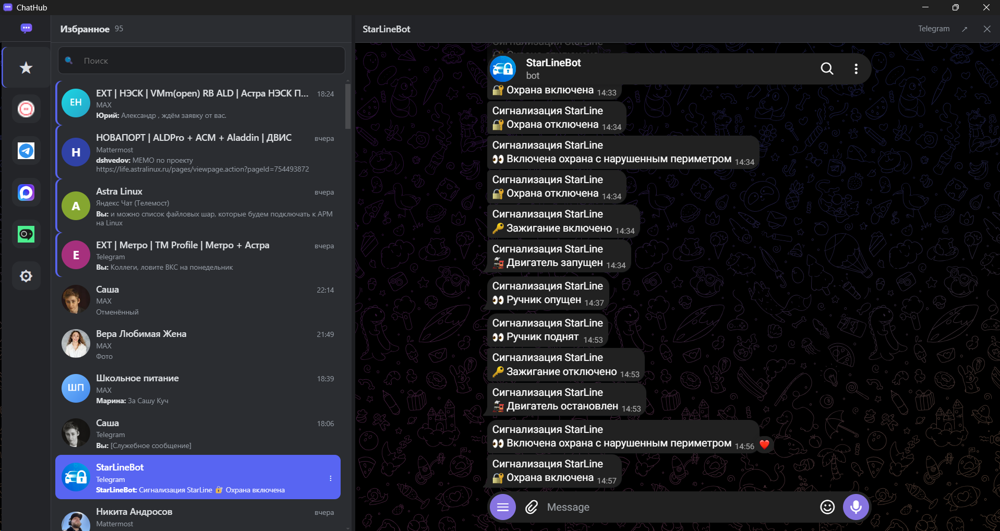

# ChatHub — все мессенджеры в одном окне

Electron-обёртка над веб-версиями мессенджеров (Mattermost, Telegram, MAX, Яндекс Чат/Телемост)
плюс «сборная вкладка» — классический мессенджер: слева общий список избранных чатов из всех
мессенджеров, справа содержимое выбранного чата.




## Запуск

    npm install   # один раз
    npm start

## Портативная сборка Windows

```text
npm run package:portable
```

**Последнюю готовую сборку можно скачать:** [GitHub Releases](https://github.com/onv83/chat-hub/releases/latest).

Готовый архив появляется в `dist/`. Его можно распаковать в любую доступную для
записи папку и запустить `ChatHub.exe`; настройки и сессии будут лежать в `data`
рядом с программой. Не копируйте папку `data` в общий, синхронизируемый или чужой каталог.

## Как пользоваться

1. Откройте вкладку мессенджера сверху и войдите (QR для MAX и Telegram — сессия сохранится).
2. Кликните нужный чат → «⭐ В избранное».
3. На вкладке «★ Сборная» — список избранного слева, чат справа. Пишите прямо в него.

Кнопка «↻ К исходной странице» на вкладке мессенджера возвращает к начальному адресу
сервиса. Если этот адрес уже открыт, страница перезагружается. В открытом чате «★ Сборной»
стрелка ↻ возвращает к сохранённому адресу этого чата.

Избранное добавляется ТОЛЬКО вручную — автосбора по папкам нет. Править можно с любой стороны:
- на вкладке мессенджера кнопка «⭐ В избранное» превращается в «★ Убрать из избранного»,
  когда открытый чат уже в избранном;
- на вкладке мессенджера меню «★ Избранное (N)»: клик по строке — открыть чат, ✕ — убрать
  конкретный чат из избранного;
- в сборной вкладке: 📌 — закрепить/открепить как в Telegram (закреплённые держатся
  наверху группы), ↗ — открыть во вкладке мессенджера, ✕ — убрать;
- полный список — в ⚙ Настройках.

### Сортировка списка избранного

Закреплённые 📌 → время последнего сообщения → позиция в списке мессенджера →
порядок добавления. Открытие чата и изменение счётчика сами по себе не поднимают чат.
Известное точное время сохраняется при обновлении метки «вчера» или даты и после
перезапуска; неизвестные часы не заменяются выдуманным временем.

Mattermost получает время из API сразу при добавлении нового чата в избранное, поэтому
такой чат занимает позицию по подтверждённому последнему сообщению без перезапуска.
В обычном фоне новая MM-проверка начинается не чаще раза в 30 секунд; полный пакет
метаданных может выполняться до 45 секунд, а зависшая скрытая service-вьюха
восстанавливается отдельно. У выбранного MM-чата короткая targeted-проверка читает
текст и автора только последнего сообщения, чтобы обновить превью; она не открывает чат
и не меняет статус прочитанного. Telegram может восстановить точное время по
метаданным последнего сообщения в уже загруженном кэше текущего аккаунта — без
открытия чата, чтения тела сообщения, поиска или прокрутки. Проверяются аккаунт,
канонический адрес, peer и ID последнего сообщения. Если проверенного кэша нет,
прежнее подтверждённое время сохраняется. MAX и Телемост пока используют время из
строк списка: восстановление точного времени вне видимого списка для них не
реализовано. Этот путь Telegram не зависит от фоновой поисковой индексации.

### Поиск по избранному

Над списком избранного — строка «Найти чат…»: фильтрует избранные чаты по названию
по мере ввода; ✕ сбрасывает фильтр.

### Вид строк избранного

В ⚙ Настройках отдельно включаются значок мессенджера и название источника
(Mattermost, Telegram, MAX, Яндекс Чат). Если название источника выключено,
его строка отдаётся превью последнего сообщения: видно до трёх строк текста.

### Непрочитанные

На вкладке КАЖДОГО мессенджера — два счётчика: всего непрочитанных и @-упоминаний
(Mattermost — по API; Telegram — красные бейджи веб-версии; MAX и Телемост своих
маркеров упоминаний не показывают — у них один общий счётчик). У чатов в сборной
вкладке — красные бейджи с числом новых сообщений, @-упоминания отдельно. На вкладке
«★ Сборная» — два суммарных счётчика ТОЛЬКО по избранным чатам: всего непрочитанных
и @-упоминаний.

Telegram, MAX и Телемост получают счётчики из видимой части виртуализированного списка.
Если показано `26+`, это означает «не менее 26»: список мог содержать непрочитанные ниже
текущей видимой области. Mattermost показывает точный итог из своего API.

## Что где лежит

- Конфиг (мессенджеры, CSS колонок, избранное, состояние окна): `%APPDATA%\ChatHub\config.json`
  — пароли и токены туда не пишутся, сессии живут в persist-партициях Electron.
- CSS «скрыть боковые панели» и масштаб настраиваются в ⚙ Настройках отдельно
  для каждого мессенджера и применяются только к чату справа в сборной вкладке.
- Состояние окна (размер/положение/максимизация) сохраняется и восстанавливается при старте;
  у Telegram-web ширина окна важна: при viewport уже ~1320 px веб-версия прячет список
  диалогов (сайдбар). Если список диалогов Telegram пропал — разверните окно шире.

### Поведение ссылок и окон

Страницы самих мессенджеров (Mattermost, Telegram, MAX, Телемост) остаются в своих
webview; страницы входа (OAuth) — попапом. Ссылки из сообщений на Jira, LIFE,
Bitbucket и другие сайты открываются в системном браузере. Отдельные окна под чаты
не создаются (окно Телемоста больше не плодится).

## Ограничения

- Mattermost: светлая тема не поддерживается — MM всегда работает в своей теме (у автора тёмная);
  в настройках ChatHub у светлой темы стоит пометка «(мм не поддерживается)».
- MAX: @-упоминания не видны во веб-версии — бейдж только с числом непрочитанных.
- Telegram: веб-версия недоступна с этой машины напрямую, поэтому вкладке Telegram
  прописан локальный прокси (⚙ Настройки → поле «прокси» у мессенджера, по умолчанию
  `http://127.0.0.1:18888`). Пока локальный прокси не запущен, Telegram не откроется.
- В этой версии встроенным веб-мессенджерам запрещены браузерные разрешения: уведомления, камера, микрофон, захват экрана, геолокация и доступ к буферу обмена. Это не меняет настройки аккаунтов, браузеров и отдельных приложений. Звонки и другие функции, которым нужно такое разрешение, используйте в отдельном клиенте до появления явного запроса согласия в ChatHub.
- Время последнего сообщения у Telegram-чатов обновляется только фоновым индексатором
  (⚙ Настройки → «Индексация Telegram», по умолчанию выключен). Пока выключен — у части
  чатов времени может не быть, они стоят ниже по порядку добавления. Mattermost/MAX/Телемост
  читаются пассивно из своих списков и всегда актуальны.

## Лицензия и участие в разработке

ChatHub распространяется по условиям [Apache License 2.0](LICENSE). Изменения, намеренно
предложенные для включения в проект, принимаются на условиях той же лицензии, если явно
не указано иное. См. также [NOTICE](NOTICE).


## Скриншот


[Открыть скриншот приложения](docs/screenshot.png)

